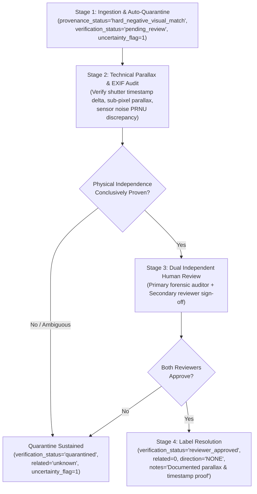

# TRACE AI — Phase 13: Dataset Collection, Annotation Guide, and Provenance Verification Protocol

**Document Version:** 1.0.0  
**Phase:** Phase 13  
**Status:** Complete & Verified  
**Date:** 2026-10-18  
**Scope:** Real-world forensic dataset collection, annotation standards, hard-negative verification workflow, and candidate isolation tooling.  
**Production Flag:** `ENABLE_PHASE4_MODELS=false` (strictly preserved)

---

## Executive Summary

Phase 13 establishes the formal, repeatable protocol for sourcing, documenting, validating, and annotating real-world photograph pairs for TRACE AI's forensic benchmark. Building directly on the Phase 11 safety evaluation framework and Phase 12 quality assurance audit tooling, this protocol guarantees that:

1. **Every contributed image** has verified consent, documented camera custody, and an immutable provenance chain.
2. **Positive pairs (`related=1`)** strictly represent shared optical sensor exposures (ground-truth lineage), distinguishing them from visually identical but physically separate camera shutter clicks.
3. **Hard-negative candidates** (burst captures, multi-angle photos of identical scenes, or re-photographed displays) undergo rigorous forensic review and are **never automatically labeled** as unrelated or related by heuristics.
4. **Uncertain pairs** are partitioned under a distinct label (`related=unknown`, `uncertainty_flag=1`) and quarantined from benchmark scoring.
5. **Candidate data is strictly isolated** in `data/real_world_benchmark/expansion_workspace/` and validated through automated provenance gatekeeper checks (`src/qa_benchmark_dataset.py --check-provenance`).
6. **Active benchmark assets, models, and tests remain intact and unpolluted.**

---

## 1. Contributor Collection Checklist

To ensure forensic integrity and prevent invalid submissions, contributors must follow this practical collection checklist before submitting image pairs:

### 1.1 Camera & Acquisition Protocol
- [ ] **Native Sensor Capture:** Capture all base images using native camera sensors (smartphones, DSLRs, or mirrorless). 
- [ ] **Disable Generative / AI Processing:** Turn off computational photography features that synthesize pixels (e.g., Portrait Mode AI bokeh, beauty filters, digital zoom exceeding optical limits, night-mode multi-frame stitching that alters sensor PRNU).
- [ ] **Preserve Original Sensor Resolution:** Retain the full camera sensor resolution for master originals.
- [ ] **Preserve EXIF Metadata:** Never strip or sanitize EXIF/XMP metadata on master camera originals; timestamps, shutter speed, ISO, focal length, and camera make/model are essential verification evidence.
- [ ] **Scene Independence for Negatives:** When capturing photographs intended as negative scene distractors, ensure each scene is captured in a completely distinct physical location or under visibly distinct environmental conditions.

### 1.2 Master Image Custody & Preservation
- [ ] **Master Isolation:** Immediately transfer raw camera files to an immutable read-only storage directory. Master files must **never be edited in-place**.
- [ ] **Unique Source ID Assignment:** Each distinct shutter click / physical scene is assigned a permanent identifier (`real_src_XXXX`).

### 1.3 Derivative Generation & Logging
- [ ] **Document Every Transformation Step:** For positive pairs, all operations applied to create Image B from Image A must be recorded contemporaneously:
  - Software name and exact version (e.g., *Adobe Lightroom Classic 13.2*, *Snapseed 2.21*, *WhatsApp Android 2.24.12*).
  - Exact parameter values (e.g., *Crop bounding box [x0, y0, x1, y1]*, *JPEG quality factor 75*, *Lanczos downsample to 1080px width*).
- [ ] **Single-Pass vs Multi-Pass Lineage:** If an image passes through a messaging or social media application (e.g., WhatsApp recompression), the exact transit chain must be noted.
- [ ] **No Unrecorded Post-Processing:** Do not apply untracked edits, cloud auto-enhancements, or screenshot captures.

### 1.4 Contributor Consent & Legal Authorization
- [ ] **Affirmative Written Consent:** Contributors must submit an explicit affirmative statement (`consent_confirmed="confirmed"` or `"written_consent"`) authorizing the inclusion of their photographs in open forensic benchmark evaluations.
- [ ] **No Third-Party Copyright Infringement:** Contributors must be the sole copyright holder of all submitted photographs.
- [ ] **Biometric & Privacy Redaction:** Photographs must not contain personally identifiable information (PII), readable government documents, vehicle license plates, or unconsented recognizable human faces.

---

## 2. Provenance Recording & Annotation Schema

All candidate pairs staged for evaluation must adhere to the standardized 16-column schema defined below:

### 2.1 Complete Schema Specification

| Column Name | Data Type | Permitted Values | Description & Integrity Rule |
|:---|:---:|:---:|:---|
| `pair_id` | String | `cand_pair_XXXX`, `pair_XXXX` | Globally unique pair identifier. Must not collide with active benchmark pair IDs. |
| `image_a` | String | Relative filename | Relative filename within the images directory. Traversal sequences (`../`, `/`, `\`) are strictly forbidden. |
| `image_b` | String | Relative filename | Relative filename within the images directory. Must exist, be readable, and pass PIL verification. |
| `source_a` | String | `real_src_XXXX` | Source ID of the underlying physical exposure for Image A. |
| `source_b` | String | `real_src_XXXX` | Source ID of the underlying physical exposure for Image B. |
| `related` | String / Int | `1`, `0`, `unknown` (`-1`) | Ground-truth forensic relationship label (see Section 3). |
| `ground_truth_direction` | String | `A_TO_B`, `B_TO_A`, `NONE`, `UNCERTAIN` | Direction of derivation. For `related=0`, must be `NONE`. For `related=1`, must be `A_TO_B` or `B_TO_A`. |
| `applied_transformations` | String | Semicolon/comma list | Semicolon-delimited list of applied operations (e.g. `crop;jpeg_compression;resize`). |
| `split` | String | `benchmark_test`, `benchmark_expansion` | Partition group. Derivatives sharing a source ID must never cross split boundaries. |
| `provenance_status` | String | `contributor_confirmed`, `controlled_synthetic`, `hard_negative_visual_match`, `candidate_unverified` | Primary categorization of provenance credibility. |
| `collection_method` | String | `camera_manual_edit`, `multi_angle_capture`, `social_transfer`, `burst_capture`, `unverified_submission` | Technical capture and derivation pathway. |
| `verification_status` | String | `contributor_verified`, `reviewer_approved`, `pending_review`, `quarantined`, `unverified` | Human QA gatekeeper status. Candidates start as `pending_review` or `unverified`. |
| `consent_confirmed` | String | `confirmed`, `written_consent`, `pending`, `unconfirmed` | Legal/contributor authorization status. |
| `provenance_chain` | String | Descriptive pipeline string | Human- and machine-readable custody chain (e.g., `camera_shutter(Sony_A7III) -> manual_crop -> export_jpeg`). |
| `uncertainty_flag` | Int | `0`, `1` | `1` indicates uncertain or quarantined pair; blocks `related=1` and isolates pair from test scoring. |
| `notes` | String | Text | Review notes, camera hardware details, lighting context, or reviewer justification. |

### 2.2 Provenance Chain Grammar
Provenance chains must be recorded as directional transformation pipelines using the `->` operator:
```text
[origin_camera_capture] -> [intermediate_tool_and_operation] -> [export_format]
```
*Examples:*
- `camera_capture(Sony_A7III, 24mm) -> manual_crop(Lightroom_Classic_13.2) -> export_jpeg(q=85)`
- `camera_capture(iPhone_13_Pro) -> whatsapp_transit(version_2.24) -> download_jpeg`
- `tripod_capture_1(Nikon_Z6, 50mm, t=0s) vs tripod_capture_2(Nikon_Z6, 50mm, t=3s, angle=+15deg)`

---

## 3. Three-Label Semantic Protocol

To prevent metric corruption and ensure unambiguous forensic ground truth, labels are strictly partitioned into three distinct classes:

```
                                  ┌──────────────────────────┐
                                  │   IMAGE PAIR CANDIDATE   │
                                  └────────────┬─────────────┘
                                               │
                       ┌───────────────────────┴───────────────────────┐
                       ▼                                               ▼
         Is there verified proof of                      Are physical captures
         shared optical exposure?                        independently proven?
                       │                                               │
             ┌─────────┴─────────┐                           ┌─────────┴─────────┐
             │                   │                           │                   │
            YES                  NO                         YES                  NO
             │                   │                           │                   │
             ▼                   ▼                           ▼                   ▼
     ┌───────────────┐   ┌───────────────┐           ┌───────────────┐   ┌───────────────┐
     │   related=1   │   │related=unknown│           │   related=0   │   │related=unknown│
     │(Verified Rel.)│   │ (Quarantined) │           │(Verified Unr.)│   │ (Quarantined) │
     └───────────────┘   └───────────────┘           └───────────────┘   └───────────────┘
```

### 3.1 `related = 1` (Verified Related Pair)
- **Forensic Criterion:** Both Image A and Image B originate from the **exact same physical sensor exposure / optical shutter event**.
- **Lineage Requirement:** One image is an ancestor or direct derivative of the other (or both derive from the identical parent raw capture).
- **Directional Constraint:** `ground_truth_direction` must be strictly `A_TO_B` or `B_TO_A` (never `NONE` or `UNCERTAIN`).
- **Source Consistency:** `source_a` must equal `source_b`.
- **Integrity Rule:** Requires `consent_confirmed` and a non-empty `provenance_chain`. Cannot have `uncertainty_flag=1`.

### 3.2 `related = 0` (Verified Unrelated Pair)
- **Forensic Criterion:** Image A and Image B originate from **separate, independent physical captures or environments**.
- **Lineage Requirement:** Neither image shares any optical pixel lineage or derived pixel transformations with the other.
- **Directional Constraint:** `ground_truth_direction` must be strictly `NONE`.
- **Source Consistency:** `source_a` must not equal `source_b` (`source_a != source_b`).
- **Hard Negatives:** Visual matches of identical scenes must prove independent shutter events before receiving `related=0`.

### 3.3 `related = unknown` or `-1` (Uncertain / Quarantined Pair)
- **Forensic Criterion:** Any pair where physical exposure identity cannot be conclusively proved or disproved.
- **Quarantine Requirement:** Any pair flagged with `uncertainty_flag=1` or awaiting reviewer sign-off.
- **Evaluation Rule:** **Strictly excluded from benchmark accuracy, precision, and recall metrics.** May be evaluated in separate diagnostic discovery modes, but never pooled into general model performance scores.

---

## 4. Hard-Negative Review Workflow (No Automatic Labeling)

### 4.1 The Hard-Negative Pitfall
Hard-negative candidates are pairs of photographs that depict the same physical objects, room, or scene, but were captured as separate shutter events (e.g., continuous burst captures, tripod bracket exposures, or multi-angle shots). 

> [!CAUTION]
> **Heuristic Trap:** Automated feature matching (SIFT, ORB), CNN image embeddings, and even casual human annotators frequently misclassify hard negatives as positive transformed pairs (interpreting camera movement as a crop or perspective transform). **Under no circumstances may hard negatives be automatically labeled.**

### 4.2 Four-Stage Review & Sign-Off Process



1. **Stage 1: Ingestion & Auto-Quarantine**
   - Candidate pairs flagged as visual matches are assigned `provenance_status="hard_negative_visual_match"`.
   - `verification_status` is initialized to `"pending_review"`.
   - `uncertainty_flag` is set to `1`.
   - Label remains `related="unknown"` until all verification stages pass.
2. **Stage 2: Technical Parallax & Sensor Audit**
   - **EXIF Timestamp Delta:** Audit internal camera clock; verify distinct timestamps (e.g., $\Delta t \ge 1.0\text{ s}$).
   - **Sub-Pixel Parallax & Occlusion Analysis:** Check for 3D parallax shifts (foreground objects shifting relative to background), dynamic shadow changes, or differing specular highlights that optical transforms cannot produce from a single 2D plane.
   - **Sensor Noise / PRNU Discrepancy:** Inspect sensor Photo-Response Non-Uniformity (PRNU) patterns across frames to verify independent noise realizations.
3. **Stage 3: Dual Independent Human Sign-Off**
   - Reviewer 1 (Data Engineer): Verifies EXIF metadata integrity and checks for file-level tampering.
   - Reviewer 2 (Forensic Reviewer): Inspects parallax and confirms physical exposure independence.
4. **Stage 4: Label Resolution & QA Verification**
   - Only when both reviewers sign off may the pair be updated to `related=0`, `ground_truth_direction="NONE"`, `verification_status="reviewer_approved"`, and `uncertainty_flag=0`.
   - The `notes` field must contain the explicit justification (e.g., *"Confirmed distinct exposures: 3.2s delta, visible parallax shift on foreground mug"*).
   - If justification is missing, automated QA tools will reject the approval (enforced by `src/qa_benchmark_dataset.py`).

---

## 5. Candidate Workspace Tooling & Isolation Architecture

To protect active benchmark integrity and prevent data contamination, candidate expansion assets remain isolated in a dedicated candidate staging workspace:

```
data/real_world_benchmark/
├── controlled_transforms/               <-- FROZEN ACTIVE BENCHMARK
│   ├── images/                          (35 verified image files)
│   └── manifest.csv                     (35 verified pair rows; frozen)
│
└── expansion_workspace/                 <-- ISOLATED CANDIDATE STAGING
    ├── candidate_images/                (Staged candidate images under review)
    ├── candidates_manifest.template.csv (Standardized 16-column template)
    └── candidates_manifest.csv          (Active expansion working manifest)
```

### 5.1 Automated Provenance Enforcement Tooling
The dataset QA auditor [`src/qa_benchmark_dataset.py`](file:///C:/Users/dell/Downloads/Trace-Ai-main/Trace-Ai-main/src/qa_benchmark_dataset.py) has been extended with strict provenance validation:

```powershell
python src/qa_benchmark_dataset.py `
  --manifest data/real_world_benchmark/expansion_workspace/candidates_manifest.template.csv `
  --images-dir data/real_world_benchmark/expansion_workspace/candidate_images `
  --check-provenance `
  --strict
```

### 5.2 Enforced Automated Rules
1. **Provenance Columns Enforcement:** When `--check-provenance` is active, the manifest must provide `provenance_status`, `verification_status`, `consent_confirmed`, and `provenance_chain`.
2. **Consent Requirement:** `contributor_confirmed` pairs without affirmative consent (`confirmed`, `written_consent`) fail validation.
3. **Chain of Custody:** `contributor_confirmed` pairs without a documented non-empty `provenance_chain` fail validation.
4. **Hard-Negative Source Integrity:** Hard negatives sharing identical source IDs (`source_a == source_b`) fail validation.
5. **Hard-Negative Label Protection:** Hard negatives labeled `related=1` or having directions other than `NONE` or `UNCERTAIN` fail validation.
6. **Justification Requirement:** Hard negatives marked `reviewer_approved` without explanatory review notes fail validation.
7. **Uncertainty Quarantine:** Pairs flagged with `uncertainty_flag=1` cannot be labeled `related=1` and cannot be marked approved without resolution.

---

## 6. Verification and Regression Testing Summary

All verification and safety regression suites were executed locally. No model inference was run, and the production safeguard `ENABLE_PHASE4_MODELS=false` was strictly preserved.

### 6.1 Test Suite Execution Log

| Test Suite | Commands Executed | Tests Passed | Status | Scope Verified |
|:---|:---|:---:|:---:|:---|
| **Phase 13 Provenance Verification** | `python -m unittest -v tests/test_phase13_provenance_verification.py` | 12 / 12 | **PASSED** | Consent enforcement, provenance chain check, hard-negative source separation, review notes justification, uncertainty quarantine, template schema conformance, and Phase 4 disabled default. |
| **Phase 12 Dataset QA Audit** | `python -m unittest -v tests/test_phase12_dataset_qa.py` | 12 / 12 | **PASSED** | Active benchmark validation, missing/corrupt image handling, traversal rejection, duplicate hash clusters, split leakage prevention, and Markdown report generation. |
| **Phase 11 Safe Evaluation** | `python -m unittest -v tests/test_phase11_safe_benchmark_evaluation.py` | 14 / 14 | **PASSED** | Checkpoint validation, fallback refusal, partial report prevention, sub-pixel isolation, and dry-run execution. |

*Total automated unit and regression tests executed in Phase 13:* **38 tests, 0 failures, 0 errors.**

---

## 7. Remaining Risks and Mitigations

| Risk Area | Risk Description | Severity | Mitigation Implemented |
|:---|:---|:---:|:---|
| **Contributor Metadata Tampering** | Contributor may inadvertently or intentionally spoof EXIF metadata or capture dates. | Medium | Stage 2 technical review requires multimodal corroboration (sub-pixel parallax and PRNU sensor noise) rather than relying exclusively on EXIF headers. |
| **Burst Exposure Ambiguity** | Rapid burst captures (e.g. 10 fps) may exhibit near-zero parallax while having independent noise floors. | Medium | Mandatory auto-quarantine (`uncertainty_flag=1`, `related="unknown"`) until dual human review resolves physical sensor independence. |
| **Social Media Transit Obfuscation** | Platform recompression (e.g. Instagram, WhatsApp) strips EXIF and introduces non-linear artifacts. | Low | Mandatory logging of transit platform and version in `provenance_chain`; controlled synthetic benchmarks maintained in parallel. |
| **Candidate Leakage into Benchmark** | Staged candidate pairs accidentally merged into active benchmark before review. | High | Physical directory segregation (`expansion_workspace/` vs `controlled_transforms/`) and strict SHA-256 manifest locking in the benchmark evaluator. |
| **Production Model Activation** | Inadvertent activation of unverified Phase 4 models in production. | Critical | Configured default `ENABLE_PHASE4_MODELS=false` enforced in `backend/app/config.py` and validated across all regression suites. |

---

## 8. Conclusion and Next Steps

Phase 13 establishes an institutional-grade, leakage-resistant protocol for real-world forensic dataset collection and provenance auditing. Candidate data remains strictly isolated in the candidate expansion workspace, protected by automated gatekeeper tooling and dual-reviewer sign-off requirements. The active benchmark (35 pairs) remains frozen, verified, and unpolluted.

**Recommended Next Step:**
When authorized, contributors may begin staging candidate photograph captures into `data/real_world_benchmark/expansion_workspace/` following the Phase 13 Checklist and Annotation Template, subjecting all entries to automated `--check-provenance` auditing.
