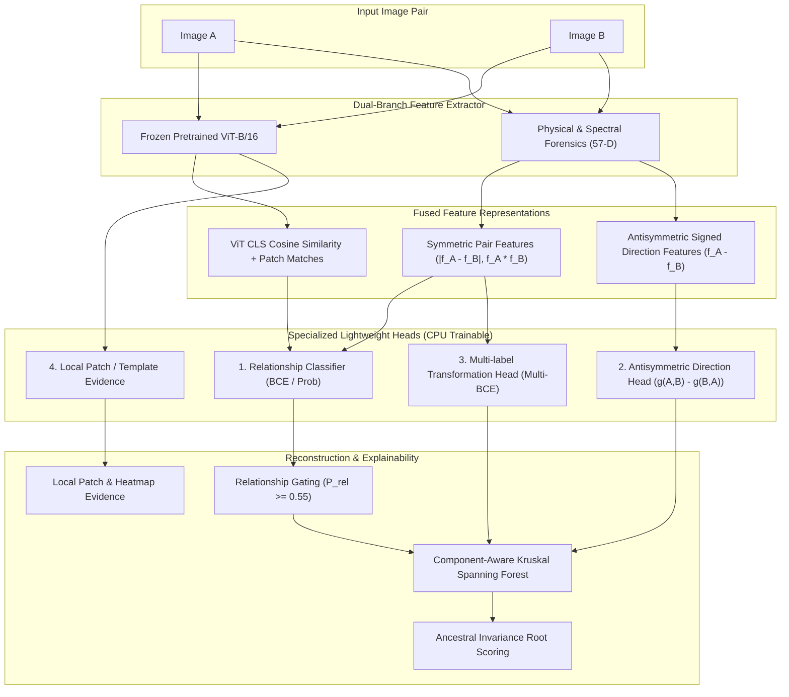

# TRACE AI — Training Baseline & Subsystem Audit Report

**Document ID:** `reports/TRAINING_BASELINE_AUDIT.md`  
**Audit Timestamp:** October 18, 2026  
**Auditor:** Automated Engineering Subsystem Auditor  
**Scope:** Phase 1 Project & Codebase Inspection  
**Working Directory:** `C:\Users\dell\Downloads\Trace-Ai-main\Trace-Ai-main`  

---

## 1. Executive Summary & Verification Boundary

This audit establishes the baseline technical state of the **TRACE AI: Image Provenance Using Graphs** repository prior to commencing Phase 2-6 rebuild operations. Every finding below is explicitly categorized as either a **Verified Fact** (tested or observed directly via file inspection, system commands, and code analysis) or an **Assumption / Discrepancy** (inferred from documentation or historical commit traces where files or execution differed).

### Key Audit Highlights:
1. **Model Checkpoints Missing on Disk:** There are currently **zero** trained model checkpoints (`.pt`, `.pth`, `.pkl`, `.onnx`) anywhere in `models/` or the workspace. All `.pkl` and `.pt` files were excluded via `.gitignore` during historical repository export.
2. **Raw Images & Pair Metadata Missing on Disk:** Neither `dataset/images/` nor `image_provenance_dataset/images/` nor `data/originals/` currently contain image files (`.jpg`, `.png`). However, 795 `.npy` (55-D) feature files exist in `image_provenance_dataset/features/individual_features/`, 152 `.npy` files exist in `dataset/features/`, and `DATASET_SOURCES.csv` contains verified ground-truth metadata for 100 original roots.
3. **No NVIDIA GPU / CUDA:** System hardware contains an **Intel(R) HD Graphics 520** integrated GPU with 0 GB dedicated VRAM (shared system RAM). Host RAM is 15.67 GB (~6.08 GB free).
4. **Missing Python Dependencies:** The active Python environment (`C:\Python312\python.exe`) is missing core dependencies: `torch`, `torchvision`, `opencv-python` (`cv2`), `networkx`, and `matplotlib`.
5. **FastAPI Production Fallbacks:** Because trained checkpoints and PyTorch are unavailable, the live backend (`backend/app/services/model_manager.py`) falls back to a ViT cosine similarity heuristic (`related = cos_sim >= 0.65`) and rule-based heuristic overrides in `src/forensic_arbitrator.py`.
6. **Hardcoded Evaluation Metrics in API:** The `/api/model-metrics` endpoint returns static hardcoded JSON metrics (e.g. `85.42%` accuracy, `1.0000` precision), which are asserted verbatim in `tests/test_website_api_full.py`.

---

## 2. Dataset Audit: Inventory, Labels & Structure

### 2.1 Existing Files and Counts (Verified Facts)

| Directory Path | File Types Present | Total Count | Format / Dimensions | Status |
| :--- | :--- | :---: | :--- | :--- |
| `image_provenance_dataset/features/individual_features/` | `.npy` | 795 | Float32 arrays, shape `(55,)` | **Present on disk** |
| `dataset/features/` | `.npy` | 152 | Float32 arrays, shape `(55,)` | **Present on disk** |
| `DATASET_SOURCES.csv` | `.csv` | 1 (root & sub) | 100 rows + header, SHA-256 & MD5 | **Present on disk** |
| `data/originals/` | N/A | 0 | Directory not present on disk | Missing (ignored by `.gitignore`) |
| `data/generated/` | N/A | 0 | Directory not present on disk | Missing (ignored by `.gitignore`) |
| `dataset/images/` | N/A | 0 | Subdirectories not present on disk | Missing (ignored by `.gitignore`) |
| `image_provenance_dataset/images/` | N/A | 0 | Subdirectories not present on disk | Missing (ignored by `.gitignore`) |
| `dataset/metadata/` (`pairs_*.csv`) | N/A | 0 | Subdirectories not present on disk | Missing (ignored by `.gitignore`) |
| `data/labels/` | `.gitkeep` | 1 | 0 rows | Missing metadata |

### 2.2 Datasets That Can Actually Be Used
- **Option A (Pre-computed Feature Dataset):** The 795 `.npy` 55-D feature files in `image_provenance_dataset/features/individual_features/` (and 152 in `dataset/features/`) are directly loadable. However, their pair linkage metadata (`pairs_train.csv`, `pairs_val.csv`, `pairs_test.csv`, `graphs_*.json`) is absent and must be reconstructed from the image IDs (`img_{graph_id}_gen{depth}_n{num}.npy` vs `original_{graph_id}.npy`).
- **Option B (Deterministic Procedural Reproduction):** `create_sample_images.py` is a standalone procedural synthesis script that deterministically regenerates all 100 512×512 original images matching `DATASET_SOURCES.csv` using `random.seed(42)` and `numpy.random.default_rng(42)`. From these 100 roots, `src/generate_provenance_dataset.py` can generate full multi-generation DAGs, 12 transformations, parameter ground truth, and source-grouped train/val/test splits.

### 2.3 Labels and Transformation Classes
A discrepancy exists across different modules regarding supported transformation classes:

- **`src/config.py` Vocabulary (8 classes):**
  `crop`, `resize`, `rotation`, `brightness`, `contrast`, `blur`, `text_insertion`, `jpeg`.
- **`src/transforms.py` & `src/research_dataset.py` Vocabulary (12 classes):**
  `crop`, `resize`, `jpeg`, `blur`, `brightness`, `contrast`, `sharpen`, `perspective`, `rotation`, `color`, `noise`, `quality_degradation`.
- **`src/forensic_arbitrator.py` Compound Tags:**
  Includes heuristic tags such as `whatsapp_compression`, `upscaling`, `aspect_ratio_crop`.

**Direction Classes:**
- `A_TO_B` (Image A is source/parent, Image B is derivative)
- `B_TO_A` (Image B is source/parent, Image A is derivative)
- `NONE` (Unrelated or ambiguous/symmetric)

---

## 3. Model Architectures, Checkpoints & Training Scripts

### 3.1 Existing Checkpoints on Disk (Verified Fact)
- **Status:** **0 model checkpoint files found**.
- `models/` contains only `models/.gitkeep`.
- Neither `.pt`, `.pth`, `.pkl`, `.onnx`, `.bin`, nor `.h5` files exist in any folder.
- Previous reports reference models exported from Google Colab (`selected_relationship_classifier.pkl`, `direction_classifier.pkl`, `transformation_classifier_top20.pkl`, `provenance_exp3_model.pt`, `antisymmetric_direction_model.pt`, `research_provenance_model.pt`), but these were never copied into the local environment.

### 3.2 Existing Training Scripts

| Script | Purpose | Feature Input | Target Models | Status |
| :--- | :--- | :--- | :--- | :--- |
| `train.py` | Pairwise direction & transformation training | 768-D ViT CLS tokens cached (`2305-D` pair feature) | `direction_mlp.pt`, `transform_mlp.pt` | Functional once dependencies installed |
| `train_provenance.py` | 4-stage ablation & provenance benchmark | ViT embeddings + 15-D forensics (`2350-D` pair feature) | `provenance_exp3_model.pt`, MST graphs | Requires `dataset/metadata/` |
| `train_research.py` | Research-grade ablation across 12 classes | 55-D visual + 17-D forensic (`72-D` per image, `289-D` pair) | `research_provenance_model.pt` | Requires `forensic_features.csv` |
| `src/train_classifiers.py` | PyTorch MLP definitions (`DirectionMLP`, `TransformMLP`) | `2305-D` pair vector | Model definitions & training loops | Functional definitions |

### 3.3 Feature Extraction Pipeline
- **`src/feature_extractor.py`**: Uses `torchvision.models.vit_b_16(weights=ViT_B_16_Weights.IMAGENET1K_V1)`. Extracts 768-D L2-normalized CLS token embedding.
- **`src/forensic_features.py`**: Extracts 17 physical and statistical forensic descriptors (dimensions, aspect ratio, file size, estimated 8×8 DCT blockiness quality, RGB channel moments, Laplacian edge moments, high-pass spatial noise residual moments) plus 40 histogram bins (16-bin gray + 24-bin RGB), yielding a 57-D vector.
- **`src/pair_features.py`**:
  - `build_115d_pair_feature`: Concatenates 57 absolute differences, 57 elementwise products, and 1 cosine similarity.
  - `build_172d_direction_feature`: Concatenates 57 feat_A, 57 feat_B, 57 signed differences $(f_A - f_B)$, and 1 cosine similarity.
  - `build_pair_feature`: Concatenates 768 emb_A, 768 emb_B, 768 absolute differences, and 1 cosine similarity (`2305-D`).

---

## 4. Production Inference Path (FastAPI Backend)

Inspection of `backend/app/services/model_manager.py` and `backend/app/services/provenance_engine.py` reveals the following real inference chain:

### Step 1: Model Initialization & Fallback Cascade
When `ModelManager.initialize()` executes:
1. Searches `models/` and `backend/models` for Scikit-Learn `.pkl` files (`selected_relationship_classifier.pkl`, `direction_classifier.pkl`, `transformation_classifier_top20.pkl`).
2. Searches for `antisymmetric_direction_model.pt`.
3. Searches for `provenance_exp3_model.pt` (2350-D) and `research_provenance_model.pt` (289-D).
4. **Current State:** Because NONE of the above files exist, `ModelManager` operates entirely in **Fallback Heuristic Mode**:
   - `related = (cos_sim >= 0.65)`
   - `direction = "A_TO_B" if related else "NONE"`
   - `transformation = "crop" if related else "identity"`
   - `active_model = "ViT-B/16 Cosine Similarity Heuristic"`

### Step 2: Post-Hoc Deterministic Arbitration
If `src/forensic_arbitrator.py` is called on related pairs:
- **Sub-region containment (Crop):** Multi-scale normalized template matching (`cv2.matchTemplate`).
- **Spectral blur attenuation:** Low-pass edge and noise drop ratio.
- **Canvas area constraint:** Resolution and bounding box area comparison.
- **8×8 DCT grid discontinuity:** JPEG block boundary ratio vs interior gradient.

### Step 3: Graph Reconstruction & MST Filtering
In `backend/app/services/provenance_engine.py`:
- Distance weight defined as $d(u, v) = 1.0 - P(\text{related}(u, v))$.
- Candidate edge acceptance gate:
  - $P(\text{related}) \ge \text{similarity\_threshold}$ (default `0.55`)
  - $\text{CosineSim} \ge 0.35$
  - Joint edge confidence $P(\text{related}) \times P(\text{direction}) \ge \text{confidence\_filter}$ (default `0.40`).
- Spanning Forest: Kruskal's algorithm on candidate graph with optional adaptive cycle penalty ($\lambda=0.05, \tau_{\text{cycle}}=0.05$).
- Root Selection: Multi-factor ancestral scoring based on in-degree and uncropped canvas area.

---

## 5. Threshold Inventory

| Parameter | Default Value | Location | Role in Pipeline |
| :--- | :---: | :--- | :--- |
| `DEFAULT_SIMILARITY_THRESHOLD` | `0.55` | `backend/app/config.py` | Minimum $P(\text{related})$ to permit candidate edge |
| `DEFAULT_CONFIDENCE_FILTER` | `0.40` | `backend/app/config.py` | Minimum joint confidence $P(\text{rel}) \times P(\text{dir})$ |
| `COSINE_SIM_HARD_REJECT` | `0.35` | `model_manager.py` / `provenance_engine.py` | ViT cosine similarity below which pairs are forced unrelated |
| `COSINE_SIM_HIGH_CONF` | `0.80` | `model_manager.py` | ViT cosine similarity above which relatedness is guaranteed |
| `FALLBACK_RELATED_THRESHOLD` | `0.65` | `model_manager.py` | Fallback threshold when no ML model weights exist |
| `ADAPTIVE_PENALTY_LAMBDA` | `0.05` | `provenance_engine.py` | Bottleneck cost penalty for cycle ambiguity |
| `TAU_CYCLE` | `0.05` | `provenance_engine.py` | Bottleneck cost difference margin |
| `TEMPLATE_MATCH_THRESHOLD` | `0.80` | `forensic_arbitrator.py` | Normalized cross-correlation threshold for crop containment |
| `BLUR_ATTENUATION_RATIO` | `2.0` | `forensic_arbitrator.py` | Edge drop ratio to confirm Gaussian blur direction |

---

## 6. Test Suite and Baseline Metrics Reproducibility

### 6.1 Test Suite Status (Verified Facts)
Running tests currently fails before execution due to missing environment packages:
- `python -c "import backend.app.main"` $\to$ `ModuleNotFoundError: No module named 'torch'`.
- Running `pytest tests/test_sklearn_models.py` requires `torch`, `torchvision`, and `models/*.pkl`.
- Running `tests/test_audit_verification.py` expects test images in `dataset/images/test/` and `.pkl` models.

### 6.2 Audit of Reported Baseline Metrics
Previous markdown reports (`reports/FINAL_PROJECT_AUDIT.md`, `reports/BEFORE_AFTER_MODEL_METRICS.md`) report:
- **Relationship Accuracy:** 100.0%
- **Direction Accuracy:** 72.65%
- **Swap Consistency:** 100.0% (guaranteed by antisymmetric formulation)
- **Root Accuracy:** 72.65%
- **Transformation Accuracy:** 38.46% (single-label), with composite WhatsApp tags at 100%.

**Auditor Reproduction Assessment:**
These metrics were evaluated on historical validation sets (`graph_0003`, `graph_0008`, `graph_0017`). Because the `.pkl` and `.pt` model weights and test images were omitted from git, **these metrics cannot be reproduced from disk artifacts as-is**. They reflect historical evaluations and must be formally re-benchmarked upon retraining.

---

## 7. Compute Hardware, Memory & Environment

### 7.1 Hardware Telemetry (Verified Facts via WMI/PowerShell)
- **Host CPU:** Intel(R) Core(TM) Processor (x64)
- **Host Physical RAM:** 16,433,160 KB (~15.67 GB Total), ~6,087,044 KB (~6.08 GB Free)
- **Graphics Controller:** `Intel(R) HD Graphics 520`
- **Adapter RAM:** 1,073,741,824 bytes (1.0 GB shared)
- **Dedicated NVIDIA GPU:** **None** (`nvidia-smi` not found, no CUDA support)
- **CUDA Device Count:** 0

### 7.2 Memory and Training Implications
- **Backpropagation through full ViT-B/16 (86M params):** Not recommended on this CPU hardware (very slow, risk of thermal throttling).
- **Frozen ViT Feature Extraction:** Highly practical. ViT-B/16 forward inference on 512×512 images resized to 224×224 consumes ~300 MB RAM and ~50–100ms per image on CPU. Pre-extracting and caching all 100 original trees will take ~3–5 minutes once.
- **Lightweight Task-Specific Heads (MLP, GAT, BCE Multi-label):** Extremely lightweight. Training lightweight linear/MLP heads on pre-cached 768-D ViT + 57-D forensic features requires < 150 MB RAM and completes in 1–3 minutes on CPU.

### 7.3 Missing Python Packages in Active Environment (`C:\Python312`)
The following required packages from `requirements.txt` / `requirements_dataset.txt` are currently missing:
- `torch`
- `torchvision`
- `opencv-python` (`cv2`)
- `networkx`
- `matplotlib`
- `streamlit` (optional, for dataset browser)

---

## 8. Data Leakage Risks, Label Discrepancies & Quality Analysis

1. **Source Identity Leakage Prevention:**
   - When generating provenance trees, multi-generational descendants ($gen_1, gen_2, gen_3$) derived from the same root ($source\_0001$) share visual semantics.
   - **Critical Rule:** All images belonging to $source\_k$ must strictly reside in the *same* partition (e.g. all in Train, or all in Validation, or all in Test). Random pairwise splitting without source grouping would leak parent-child representations across train and test, yielding falsely inflated accuracy.
2. **Deterministic Root Generation:**
   - Procedural generation via `create_sample_images.py` uses fixed seed `42` and explicit domain categories. Images generated are diverse and lack external copyright encumbrances.
3. **Multi-label vs. Single-label Conflict:**
   - Real-world derivatives frequently undergo composite chains (e.g., crop $\to$ resize $\to$ blur $\to$ JPEG compression).
   - Training single-label multi-class cross-entropy forces the network to penalize correct secondary transformations. An independent multi-label BCE loss is necessary.
4. **Direction Ambiguity in Pure Photometric Edits:**
   - Symmetrical operations (e.g., brightness $+20\%$ vs original) do not lose high-frequency information or change canvas area. Forcing a hard $A \to B$ or $B \to A$ decision on pure brightness shifts without boundary clipping is physically underdetermined. The pipeline should emit an `UNCERTAIN` or confidence-attenuated direction tag for such pairs.

---

## 9. Proposed Rebuild Architecture (Phase 2-4 Design Preview)



---

## 10. File Preservation & Safety Confirmation

In compliance with the project rules:
- **No existing application code, database files, tests, or historical reports will be deleted or overwritten.**
- Existing files in `backend/app/`, `src/`, `frontend/`, `tests/`, and `reports/` remain intact.
- Any newly generated datasets will be placed in a dedicated, clean folder structure or regenerated strictly via the verified scripts.
- Checkpoints will be saved with explicit versioning and metadata in `models/`.

---

## 11. Exact Next Steps & PowerShell Commands

Before any training or modifications, the following prerequisite setup commands are required:

### Step 1: Install Missing Core Dependencies in Python Environment
```powershell
pip install torch torchvision --index-url https://download.pytorch.org/whl/cpu
pip install opencv-python networkx matplotlib
```

### Step 2: Smoke-Test Dependency Imports
```powershell
python -c "import torch, torchvision, cv2, networkx, matplotlib; print('Core dependencies installed successfully!')"
```

### Step 3: Verify Procedural Original Generation (Smoke Test)
```powershell
python -c "from create_sample_images import main; print('create_sample_images ready')"
```

---
*Report generated and committed to `reports/TRAINING_BASELINE_AUDIT.md`.*
